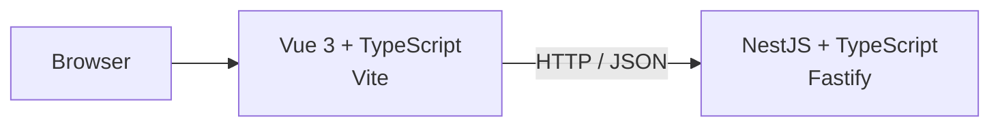

# Architecture — Commit 1

The frontend and backend are independent TypeScript applications. Vue does not run inside NestJS, and NestJS does not depend on Vue.

This separation allows the API to evolve independently from the presentation layer and keeps domain/application concerns out of the frontend.
